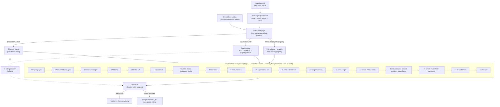

# 06 — Property listing wizard (homeyhuts.com/host-your-property)

**Captured live, logged in, 2026-11-11.** Every step page was opened read-only
with a placeholder id (nothing was saved and no draft was created). Step order
and step codes come from the page code (`stepCodeToRoute`, `currentStep`).
Reference for **Aman's Property & Unit Management** and Bleiben's first-property setup.

## Flowchart

## Entry points

| From | Goes to |
|---|---|
| Portal "Start free trial" (signed out, or signed in without a host account) | `/start-trial`: **14 days free trial · All-in-One Hosting**. Explains that after sign-up you continue listing, and the team connects and syncs Airbnb, MMT and other OTAs. Fields: Full Name \*, Email ID \*, country code + Phone Number \*. Submitting accepts the Master Service Terms. Back / Continue. Creates the host account. |
| Host panel → Properties → **Create New Listing**, or avatar menu → Create New Listing | `homeyhuts.com/host-your-property/add-property` |
| An existing `HHHost` clicking "Start free trial" | Straight to `host.homeyhuts.com/listing` |

## Start page — `/host-your-property/add-property`

- Title "Setup your property on Homeyhuts" and a one-line PMS + channel manager explainer.
- Stepper: **1 Add Your Property → 2 Complete Your Listing → 3 Connect Your OTAs**.
- "CHOOSE HOW TO ADD YOUR PROPERTY": three selectable cards. The button label follows the selected card.

| Card | Button | What happens |
|---|---|---|
| Import from Airbnb (tag "Fastest", selected by default) | Continue with Airbnb import | One-time sign-in with **Channex** (integration partner). A note says to disconnect Airbnb from any other PMS/CM during import. Route `/clone/airbnb`. |
| Create Manually | Continue to create manually | `POST /property/api/v1/property` creates a **draft** and returns `propertySerialId`. Then `/host-your-property/{id}/property-type`, or `/host-your-property/{id}/chat` for the AI assistant. |
| Clone Homeyhuts Property | Continue to clone a property | `/host-your-property/clone/homeyhuts`. Pick one of your listings and give it a title (`property/copy-exiting-property/{serialId}?title=`). |

## The steps — `/host-your-property/{propertySerialId}/{step}`

Common chrome on every step:
- Top bar with **Save as Draft** and the avatar menu; **Back / Next** at the bottom.
- Each Next saves `{propertySerialId, …fields, propertyCurrentStep: <code>}` to
  the property API. Because the current step is stored on the property, a
  host who leaves can **resume where they stopped**.
- Each step also logs a funnel event (`stepName`, `stepNumber`).

| # | Route | Step code | Page and fields |
|---|---|---|---|
| 1 | `property-type` | `property_type` | **Select your property type** (one): House, Villa, Cottage, Apartment, Farm House, Beach House, Bed & Breakfast, Boutique Hotels, Tree House, Chalet, Glamping, Unique Stay, Hut, Lodge, Dome, Boat House, Campsite, Destination Wedding. Validation: "Please select an option". |
| 2 | `accommodation-type` | `accommodation_type` | **What is the accommodation type** (one, with an explainer each): Entire House/Apartment · Private Space in a Shared House · Private Guest Suite · Private Room in Shared Accommodation · Shared Room |
| 3 | `owner-manager` → `property-address` | `property_owner` | Whether you're the owner or the manager *(rendered only for a real draft; from code)* |
| 4 | `property-address` | `property_address`, `property_address_detail` | Google Places autocomplete (street number, route, sublocality, locality, admin area, postal code, country), then **House/Flat No. and Street Name \***, **Nearby Landmark**, City \*, State, Pincode \*, Country. Fields **lock once the property is activated**. |
| 5 | `property-photos` | `property_photo` | **Upload your property photos**: drag & drop or browse (SVG, PNG, JPG, JPEG). **At least 10** required, 15–20 recommended; the first 10 show first. A cover photo is a separate type (`property_cover`). |
| 6 | `property-document` → `more-information` | `property_proof` | Property proof / verification documents (`property_verification` files) |
| 7 | `more-information` | `about_property` | **More details**: counters for **Guests allowed, Beds, Bedrooms, Bathrooms** |
| 8 | `amenities` | `amenities` | **Detailed amenities** (multi): Wifi, TV, Kitchen, Washing Machine, Hair Dryer, AC, Free Parking, Swimming Pool, Hot Tub, Fire Extinguisher, Gym, Beach Access, Smoke Alarm, First Aid Kit, Sound System, Garden/backyard, Outdoor seating, Cleaning before checkout, plus **Add More Amenities** |
| 9 | `uniqueness` | `unique_about_property` | **What is unique** (up to 4) from about 33 tags: views (city, ocean, lake, mountain, valley, river…), vibes (peaceful, family, romantic, business-friendly), private pool, historic charm, glamping… |
| 10 | `experiences-offered` | `property_experience` | **Experiences offered** (up to 4, optional photos): cooking classes, safari, yoga, massage, village/heritage tours, trekking, river rafting, bonfire, stargazing, … about 26 options. Must be genuinely on-site or within a 5-minute walk. |
| 11 | `property-title` | `property_title` | **Title** (max 100), **Description** (max 10,000), **YouTube video / Instagram reel link** |
| 12 | `neighbourhood` | `property_neighbourhood` | **Describe the neighbourhood** (safety and surroundings), max 10,000 |
| 13 | `price` | `property_price` | **Base price per night**. Later edits happen in the property calendar; OTA price sync is done from the app. |
| 14 | `checkin-checkout` | `check_in_out` | **Check-in time**, **Check-out time** (editable later in Manage Listings) |
| 15 | `house-rules` (shared page) | `security_camera`, `instant_booking`, `cancellation_policy`, `house_rules` | One long page, **House Rules** (guests agree before booking): toggles for Child-friendly (2–12), Infant-friendly (<2), Pets allowed, Smoking, Parties/events, each with a reason. "Additional details about your home" checkboxes: stairs, noise, pets on property, no on-site parking, shared spaces, amenity limitations, weapons, **surveillance devices** (the security-camera step), dangerous animals. Additional rules text up to 5,000. **Instant booking** on/off. **Cancellation policy**: *standard* (stays under 28 days: **Flexible** or **Moderate**, with refund tiers by hours before check-in) plus a *long-term* (28+ nights) policy. |
| 16 | `checkin-method` | `check_In_method` | **Check-in method** (one): *Host greets you* / *Keypad* / *Building staff*. Then **Caretaker / Manager** name and phone for on-ground support. |
| 17 | `account-verification` | `account_verification` | ID check (Pending). You can publish now and verify in the app (QR code, store links, three steps). |
| 18 | `property-preview` | — | Preview the listing as a guest would see it |
| 19 | `publish-property` | `publish_property` | "You're almost done": property card plus **"Book a Quick Setup Call"** (free one-to-one online call where the team connects your OTAs and syncs calendar and rates), then "Preview property" and "contact our team". |

After the last step:
- A **draft** goes to `host.homeyhuts.com/listing`.
- An **activated** property goes to `listing/properties/{id}?tab=update-listing`.
  The pricing calendar is at `?tab=calendar`.

## AI listing assistant (beta) — `/host-your-property/{id}/chat`

- A chat on one side and a **live listing preview** with a % complete on the other. Auto-saved.
- Flow: drop in a few photos and a sentence about the place. The AI pre-fills
  amenities, highlights and a draft title, then asks one question at a time. You
  review each step and publish when ready ("most hosts finish in 8–12 minutes").
- You can switch back to the step-by-step form at any time ("← Back to chat").

## What Bleiben should copy (structure, not text)

- A property is created as a **draft on the first step** and every step saves
  immediately with a `current_step`, which makes the wizard resumable for free.
- Enumerations to seed: property types, accommodation types, amenities,
  unique tags, experiences, house-rule toggles, check-in methods, cancellation policies.
- Hard validations: an option on choice steps, address required fields,
  **≥ 10 photos**, title ≤ 100, description ≤ 10,000, base price.
- Separate **room/unit** setup isn't in this wizard (homyhuts sells the whole
  property; units/rooms come via Magic Cluster). Bleiben's PRD needs units, so
  add a "Rooms & units" step after **more-information** (step 7).
- Lock identity fields (address) after activation.
