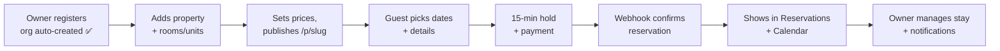

# 07 — Host Control Center: Homeyhuts REA mapped to the Bleiben MVP plan

Source plan: *Bleiben — Host Control Center MVP Development Plan* (14 pages).
Each module below has three parts:

1. **Plan:** release and scope, from the plan.
2. **Homeyhuts reference:** what host.homeyhuts.com actually has.
3. **Bleiben R1 build:** what to build, the screens, and the API.

**How the REA was done (2026-11-12).** Logged in to homyhuts with the owner's
phone account and inspected the Host Control Center read-only; nothing was
created or changed.
- The account has no property and no connected channel manager, so
  homyhuts **locks every tab except Properties**: locked routes redirect to
  `/listing`.
- Locked screens were therefore reverse-engineered from the host-panel code.
  Each screen is a lazy chunk; its route table, labels, columns, filters,
  states and API calls were extracted.
- Tags: **[live]** = seen in the browser; **[code]** = from the shipped code.

Scope rule from the plan: *use Homeyhuts as a product/UI reference, not a reason
to copy every feature.* Each module's "Not in R1" line lists the extra features
homyhuts has that Bleiben skips in R1.

---

## 0. Navigation and shell

| Plan nav item | Release | Homeyhuts equivalent | Bleiben R1 |
|---|---|---|---|
| Dashboard | R1 | `/dashboard` [code] | Yes |
| Calendar | R1 | `/calendar` [code] | Yes |
| Properties | R1 | `/listing`, `/listing/properties/:id` [live] | Yes |
| Reservations | R1 | `/reservations` [code] | Yes |
| Expenses | R2 / optional | `/expenses` [code] | Hidden in R1 |
| Inbox | R1 notifications, R2 inbox | `/inbox/:threadId` [code] (full unified inbox) | R1 = Notifications only |
| Channel Manager | R1 (iCal) | `/channel-manager` [code] (official API based) | R1 = iCal |
| Support | R1 link, tickets later | Header **Support** panel with tickets [live] | R1 = help link + contact |
| Settings | R1 basic | Portal `/account/*` + host `/account` [live] | Yes (built: Account settings) |
| Team Management | R2 advanced | Per-property **Co-Hosts** tab [code] | R1 = basic org roles (built) |
| Subscription & Billing | R1 | `/account/subscription-billings` + dues [code] | Yes |

**Homeyhuts shell [live]:**
- Horizontal top nav: logo · Dashboard · Calendar · Properties · Reservations ·
  Expenses · Inbox · Support · Refer & earn (gift icon) · tutorials (YouTube icon) ·
  avatar initial + ☰ menu.
- Avatar menu: Create New Listing, Host Control Center, Home, About Us, Trips,
  Account Settings, Contact Us, Help Center, plus content links, then Logout.
- **Gating:** each route declares `open`, `ownerOnly` or `feature(<code>)`. A plan
  gate shows a banner with a reason and a CTA ("Connect your channel manager to
  unlock all tabs") and puts a 🔒 on locked tabs.

**Bleiben R1:**
- Same shell, Bleiben branding. Nav order: Dashboard · Calendar · Properties ·
  Reservations · Channel Manager · Notifications, then Settings and Subscription
  under the avatar, plus a Help link.
- Every route declares an access rule that matches `backend/src/roles.js`.
- Use one gate for the subscription: **trial expired → read-only, 7-day grace**
  (the plan's rule). Show it as a banner with a reason and a CTA, like homyhuts.

---

## 1. Dashboard — R1

**Plan:**
- **Booking overview:** total, today, upcoming, by status, by source.
- **Check-ins/outs:** today's check-ins and check-outs, arrivals, pending check-outs.
- **Property overview:** properties, units, available / booked / blocked.
- **Payment overview:** booking value, advances collected, pending balances, failed payments.
- **Quick actions:** create property, manual booking, open calendar, block dates, view reservations.

**Homeyhuts reference [code]**
- **Period picker:** Last 7/30/60 days, Next 7/30/60 days, Custom range.
- **Scope filters:** All listings / Single listings / Multi (cluster) listings, location, property.
- **"Count bookings by"** check-in date, check-out date or booking date. Refresh button.
- **Today panel:** tabs **Check-ins / Check-outs / Ongoing stays / Arriving in next 2 days**, "Show all", empty state.
- **Quick actions:** **Add direct booking** (offline or phone booking), **Add expenses**, **Properties**, **Manage expenses**.
- **KPI cards** (each with an info tooltip): Net revenue, Expenses, **Net operating income**, **Occupancy**, **Net ADR**, **Net RevPAR**.
- **"Where bookings come from":** source table (Source, Nights, Share) with "View bookings". Blocked nights are excluded.
- **Occupancy outlook:** weekly heat legend (≥50 %, 25–49 %, <25 %, not offered).
- **Charts and tables:** Revenue and expenses by month ("hover any month"), Where money goes (category / amount), Performance with **Rank properties by**.
- **Error state:** "We couldn't load your figures… nothing is wrong with your data", with Try again.
- API: `booking/host-dashboard`, `host-dashboard-info`, `day-wise-count`, `total-earning`, `recents`, `property/property-occupancy-list`.

**Bleiben R1 build**

| Screen | Contents |
|---|---|
| Main Dashboard | Period picker (today / next 7 / 30 / custom). Cards: total reservations, upcoming, confirmed / pending / cancelled, by source (direct / OTA-iCal / manual). Properties, units, available / booked / blocked tonight. Booking value, advance collected, balance pending, failed payments. |
| Today panel | Tabs: Check-ins · Check-outs · In-house · Arriving next 2 days (homyhuts pattern) |
| Quick actions | Create property · Create manual booking · Open calendar · Block dates · View reservations |
| Upcoming / Booking overview / Payment overview | Pre-filtered Reservations list views, not separate pages |

API: `GET /api/dashboard/summary?from&to&property_id` returns all cards in one
call. Org-scoped (`orgScope`, `dashboard.read`) and computed server-side.
*Not in R1:* NOI, ADR, RevPAR, expense widgets, occupancy outlook, property ranking (R2 analytics).

---

## 2. Calendar — R1

**Plan:**
- **Monthly and timeline views**, with property and room filters.
- **Availability:** block / unblock dates with a reason.
- **15-minute booking holds** that release automatically, and **conflict prevention**.
- **Screens:** Block Dates modal, Availability details, Booking drawer, Conflict details.

**Homeyhuts reference [code]**
- **Multi-property timeline:** properties as rows, dates as columns. Moves in **15-day pages** (Previous / Next 15 days).
- **Search and filters:**
  - Search by name, id or city. Plan Type filter. **Entire Mode** toggle for clusters.
  - **Filters:** location, plus **occupancy over a date window** (less than / greater than / between, 0–100 %).
- **Toolbar:** Create Booking · Create Offline Booking · Flexi Pricing (bulk).
- **Select dates on a row** opens a panel with:
  - **Availability:** Block dates / Unblock dates, **Notes / reason** (with "Overwrite notes for all blocks"), Block all / Open all dates.
  - **Pricing:** **Set price** or **Adjust by %**, "New nightly price" synced to all channels.
  - Buttons: Update Availability · Update Pricing & Availability.
- **Flexi Pricing:** pick properties, then a **date range**, **apply on these days** (weekdays), and an adjustment.
- **Feedback:** toasts (dates blocked or opened, pricing or notes updated). Co-host states: **View-only access** and **No access to these dates**.
- API: `property/unified-cal-property-list`, `all-property-price`, `all-property-blocks`, `property-block-date` (+ `/bulk`, `/bulk/delete`, reasons, history), `property-manage-price` (+ `/bulk-update`, `/by-percentage`).
- Homyhuts has **no booking holds**, since OTAs hold inventory. Holds are Bleiben-specific (direct checkout).

**Bleiben R1 build**

| Screen | Contents |
|---|---|
| Timeline Calendar (default) | Rows = rooms/units grouped by property; columns = dates. Booking bars with guest name and source colour; blocked cells with reason; **held** cells with countdown; check-in / out markers. Navigate by 2 weeks or a month. |
| Monthly Calendar | One property: month grid with per-day availability counts |
| Block Dates modal | Unit(s), date range, reason, notes. Also unblock. |
| Availability Details | Click a cell to see per-unit status, price and any hold or booking |
| Booking Details drawer | Opens the reservation (same component as in Reservations) |
| Conflict Details | Overlapping items (booking / iCal event / block) with source and dates, plus a resolve action |

Backend (integrity lives in the **database**, as the plan's implementation note requires):
- `inventory_day` (or a unit + date-range table) with an **exclusion / unique constraint**, so two confirmed or held stays can't overlap.
- `POST /api/holds` creates a 15-minute hold inside a transaction. A **hold-expiry worker** runs every minute.
- Payment webhook converts hold → booking.
- APIs: `GET /api/calendar?from&to&property_id`, `POST/DELETE /api/blocks`, `GET /api/availability`.
- *Not in R1:* Flexi pricing by %, occupancy filters, Entire Place Mode / clusters.

---

## 3. Properties — R1

**Plan:**
- **All properties:** search by name, id or city; status filter; pagination; create / edit / archive.
- **Wizard:** basic info → location → details (photos, amenities, rules, times, cancellation) → **room configuration** → pricing (base, extra guest, advance %) → preview, draft, publish.
- **Room CRUD** and **Payment Gateway Settings**.

**Homeyhuts reference**
- **All Properties [live]:**
  - Search by name, id or city. Status filter: All / Activated / Deactivated / Declined / Draft.
  - **Create New Listing**. Columns: Id · Title · City · Status · **Payment Gateway**.
  - The Payment Gateway column has a per-row toggle and a column "All" toggle; changes need a confirm with Save or Cancel.
- **Payment gateway activation [code]:**
  - An explainer covers how it works (processed by Razorpay), fees & settlement, settlement delays and refunds.
  - The host selects properties, reads the agreement (scroll), ticks "I have read and agree", then **Activate**.
- **Create listing wizard [live]:** 19 steps on the portal. See [06-property-listing-wizard.md](06-property-listing-wizard.md) and its flowchart.
- **Property detail tabs [code]:** **Property Info · Calendar & Pricing · Update Listing · Activity · Co-Hosts**.
  - *Update Listing* holds the editor: type, category, address, photos, amenities, guests & rooms, pricing settings, discounts, tax/GST, times, house rules, cancellation, check-in method, documents.
  - *Activity* is the change log.
- **Magic Cluster [live]:** New Cluster; table with Cluster Name / Id / Mapping / Entire Place Mode / Action. Delete makes the child listings independent again. This is homyhuts' way of modelling **multiple units**.

**Bleiben R1 build**

| Screen | Contents |
|---|---|
| All Properties | Search (name / id / city), status (Draft / Published / Archived), pagination; columns Name · City · Units · Status · Booking page (link) · Payments (connected?) |
| Create Property (wizard, resumable) | 1 Type → 2 Basics (name, description, contact) → 3 Location (country, state, city, address, PIN, map pin) → 4 Photos (min 5 for MVP) → 5 Amenities → 6 House rules + check-in/out times + cancellation policy → **7 Rooms & units** (name/type, capacity, unit count, photos, amenities) → 8 Pricing (base nightly per room type, extra-guest charge, advance %) → 9 Preview → Publish. Draft is created at step 1 and saves `current_step` (homyhuts pattern). |
| Property Details | Tabs: Overview · Rooms · Calendar & Pricing · Edit listing · Activity |
| Room Listing / Add-Edit Room | Room type, capacity (adults, children), **inventory count**, base price, extra guest, photos, amenities, archive |
| Property Preview | Renders the public booking page (`/p/{slug}`) in preview mode |
| Payment Gateway Settings | Connect the owner's gateway (Razorpay keys or OAuth), test mode, status (Payments module) |

API: `/api/properties` (CRUD, `status`, `current_step`, `slug` unique), `/api/properties/:id/rooms` (CRUD),
`POST /api/properties/:id/photos`, `POST /api/properties/:id/publish`. All org-scoped with `properties.read` / `properties.write`.
*Not in R1:* AI listing assistant, Airbnb import (Channex), clone, Magic Cluster, Entire Place Mode, discounts, GST settings.
**Owner: Aman.**

---

## 4. Reservations — R1

**Plan:**
- **List:** search by id or guest; filters for property, room, source, date and status.
- **Statuses:** inquiry, held, pending payment, confirmed, checked-in, checked-out, cancelled, expired, no-show.
- **Actions:** create, edit, cancel, confirm, record payment, check-in/out.
- **Sources:** direct, Airbnb, Booking.com, phone, WhatsApp, walk-in, manual.

**Homeyhuts reference [code]**
- **Tabs:** General · Arriving Soon · **Pending Review** · Today · **Checking In** · **Checking Out** · Others · **Booking requests** (direct-site requests to approve / decline) · **Offline Bookings** · **Booking Leads** · **Transactions**.
- **Filters:**
  - Search booking or guest; Property (multi-select); Source (Homeyhuts Direct, Airbnb, Booking.com, MakeMyTrip/Goibibo…).
  - Trip status: Upcoming / Ongoing / Completed / Cancelled. Plan type. Payment: Online (payment link) / Offline (cash / UPI).
  - Check-in from–to; booking date from–to; "More filters".
- **Columns:** Booking ID · Trip Status · Check In/Out · Guest · No. of guests · Source · Payment Status (**Total / Paid / Balance**) · Amount · Action.
- **Actions:**
  - **Create Booking**, **Offline Booking** (with an "Offline Booking Payment" record).
  - **Export to Excel** / Download report by date range. Mark as paid.
  - Cancelled-by-guest request state.
- **Booking Leads:**
  - Columns: Property, Check In/Out, User, Status.
  - Detail: user and booking details; **Mark as Booked / Not Booked**.
- **Transactions:**
  - Bookings Transaction: Guest paid · Transaction fee · Your payout · Expected payout, Payment Id, Transfer Id; "payouts within 48 hours".
  - **Adjustments:** Outstanding / Owed / Recovered (recovered from the next payout).
  - Summary: last 7 / 30 days / 12 months.

**Bleiben R1 build**

| Screen | Contents |
|---|---|
| All Reservations | Quick tabs: Upcoming · Today (arrivals / departures) · In-house · Pending payment · Cancelled · All. Search (booking id, guest name / phone). Filters: property, room, source, status, check-in range, booking date. Columns: ID · Guest · Property / room · Dates · Guests · Source · Total / Advance / Balance · Status. Export CSV. |
| Create Reservation | Property → room / unit → dates (live availability check) → guests → guest contact → price (auto from rates, editable) → advance received + method (cash / UPI / card / payment link) → source (phone / WhatsApp / walk-in / manual) |
| Reservation Details | Everything in the plan's "booking information", plus a timeline (history of state changes, payments and notes) |
| Edit / Cancel | Edit permitted fields (guest info, notes, guest count within capacity). Cancel with a reason, applying the policy refund rule; frees inventory. |
| Check-in / Check-out | Mark arrived / departed, ID note, balance collection |
| Payment Details | Payments list (advance, balance, refunds) and **record payment** |

State machine (server-enforced):
- `inquiry → held → pending_payment → confirmed → checked_in → checked_out`
- `held → expired`
- `confirmed → cancelled | no_show`

Every transition writes a `booking_events` row.
API: `/api/bookings` (list, create, get, patch), `POST /api/bookings/:id/{confirm,cancel,check-in,check-out,payments}`.
*Not in R1:* booking leads, OTA request approve / decline, payouts and adjustments ledger, plan-type filters.

---

## 5. Expenses — R2 / optional (not in R1)

**Homeyhuts reference [code]:**
- **List:** property, category, payment mode, amount range, attachments with/without, month / custom range; sort; **Export to Excel**.
- **Add/Edit:** date, property, category, amount, payment mode, attachments.
- **Monthly recurring** rules: repeat every month, skip a month with a reason, unskip, stop from today, edit amount for future months. "Expenses are locked" state.
- 17 categories in the dashboard's "Where money goes".
- API `property/api/v1/property-expense`.

**Bleiben:** don't build in R1. When R2 starts, copy this structure. The plan's categories (electricity, water, internet, housekeeping, maintenance, staff, laundry, supplies, other) plus recurring rules and the P&L.

---

## 6. Inbox → R1 Notifications, R2 Inbox

**Plan:**
- **R1:** booking confirmation, payment success / failure, cancellation, owner alerts, email + SMS fallback, delivery status.
- **R2:** unified inbox, WhatsApp, templates, team assignment.

**Homeyhuts reference [code], all of it R2-level:**
- **Conversations:** search guest, property or message; filters by channel, listing, **trip stage**, unread, starred, archived. "Waiting on you, most urgent first".
- **Reply times:** typical and average, by agent; "Within 1 hour".
- **Thread view:** team note (never sent to guest), star / priority / archive.
- **Quick replies** with auto-filled variables, e.g. guest first name, check-in date, nights, property, map link, check-in method / instructions, caretaker name/phone, Wi-Fi, door code, house rules, cancellation policy.
- **Send later**, scheduled for IST.
- **Airbnb actions:** pre-approve, accept, decline, special offer; "suggest nearest free dates".
- API `messaging/api/v1/threads/*`.

**Bleiben R1 build**

| Screen | Contents |
|---|---|
| Notifications | Bell + list: booking confirmed / cancelled, payment received / failed, hold expired, iCal conflict. Read / unread; filter by type. |
| Notification Details | Event, linked booking, delivery status per channel (email ✓, SMS ✓ / ✗) |

Backend: a `notifications` table plus a notification service that reuses Bleiben's mailer (Brevo, already working) and an SMS provider. Store delivery status.
Guest emails: booking confirmation, payment receipt, cancellation.
**Seed the template variables** now (homyhuts' variable list above is a good set) so R2 WhatsApp templates reuse them.

---

## 7. Channel Manager — R1 = iCal

**Plan:**
- **Connect** Airbnb or Booking.com by iCal URL and map it to a unit.
- **Import:** parse, dedupe, process cancellations. **Export:** unique iCal URL per unit.
- **Monitoring:** last sync, status, errors, manual sync, retry, conflict alerts.
- Official APIs come later.

**Homeyhuts reference [code]:**
- The main channel manager is **API-based** (owner-only `/channel-manager`):
  - Rates / inventory grid in 15-day pages. Bulk Update of inventory or rate (date range, weekdays, Next 5/7/14/30/90 days).
  - Increase / decrease price by % (capped at 20). Filters for service type and occupancy. "Show only base rate".
  - Full sync with logs; live feed.
- **iCal exists separately:** `property-calender-sync/list | refresh | disconected | other-ota-list`, for OTAs without an API.
- The gating rule (no CM → only Properties) doesn't apply to Bleiben.

**Bleiben R1 build**

| Screen | Contents |
|---|---|
| Channel Manager Overview | Per property / unit: connected feeds (channel name, last sync, status ✓ / ⚠, next sync), **export URL** (copy), "Sync now" |
| Connect Channel | Channel (Airbnb / Booking.com / Other), iCal URL, name, **map to unit**; validate by fetching once before saving |
| Channel Configuration | Edit mapping, interval, disconnect |
| Sync History / Sync Errors | Runs: time, events added / updated / removed, error text, retry |
| Conflict Management | Overlap list (iCal event vs Bleiben booking / hold / block), source + dates, actions: keep / cancel / mark resolved, owner alert |

Backend:
- `channel_feeds`, `external_events` (with UID-based dedupe), `sync_runs`.
- A scheduled worker (e.g. every 15 min) with retry and backoff.
- Exporter route `GET /ical/:token.ics` (unguessable token per unit).
- Conflict detection runs on import **and** on booking confirm.

Tell owners up front that **iCal isn't instant**: delay = sync interval.

---

## 8. Support — R1 link, tickets later

**Homeyhuts reference [live]:**
- Header **Support** opens a side panel. Tabs: **Report an issue · Feedback · My tickets (n)**.
- Form: property \*, category \* (Unified Calendar, Unified Inbox, Expenses, Property Calendar, Reservations, Pricing, Direct Booking website, Reporting & Dashboard, Others), description (≤ 1000), up to 2 attachments (5 MB each, JPG/PNG/PDF), **Raise ticket**.
- Email when a ticket opens or closes. Also a "Contact support" mailto in banners.

**Bleiben R1:**
- **Help Center:** static FAQ / guides (getting started, property setup, bookings, payments, iCal).
- A **Contact support** link (email or WhatsApp) in the header and on error screens.
- Later: copy homyhuts' ticket panel as above.

---

## 9. Settings — R1 basic

**Plan:**
- **Profile;** **organisation** (name, details, contact, address, logo).
- **Property preferences:** default check-in/out, cancellation, tax, pricing.
- **Notifications;** **security** (sessions, login history, audit).

**Homeyhuts reference [live]:**
- Portal **Account Settings**: Personal info (photo, email Edit with OTP, phone Add with OTP, name, DOB, address, about, email notifications toggle, deactivate) and Account Verifications.
- Host `/account` tabs Profile · Verification · **Payout Details** (bank account) are placeholders on this account.

**Bleiben status:**
- **Already built:** `frontend/lib/features/account/` and `/api/account` — Personal info, Account Verifications, Team & roles (org name + roles).
- **R1 still to add:**

| Screen | Contents |
|---|---|
| Organization Settings | Business name, contact email / phone, address, **logo** (used on the booking page), GST number (optional) |
| Property Preferences | Defaults applied to new properties: check-in/out times, cancellation policy, tax %, advance % |
| Notification Settings | Email / SMS toggles per event: new booking, payment, cancellation, calendar conflict |
| Security Settings | Active sessions (device, last seen, revoke), login history |
| Activity Logs | Org audit log (who changed what): reuse `booking_events` + a generic `audit_log` |

---

## 10. Team Management — R2 advanced (R1 = basic roles)

**Plan:**
- **Invite**, with roles Owner / Manager / Staff / Read-only.
- **Per-property access**, and per-module permissions (properties, reservations, calendar, financials).

**Homeyhuts reference [code]:**
- Team is **per property**: property detail → **Co-Hosts** tab → **Add co-host** ("you choose exactly what they can see and do").
- Per-feature levels **No access / Read only / Full access**, with a **Set all** shortcut.
- Features: dashboard, calendar, reservation, property, expense, inbox.
- Invite by email or copy link. Statuses pending / active / revoked. The invitee accepts at `/co-host/invite/:token`.
- Screens without access show **View-only access** or **No access to these dates**. Agent figures show only to full-access members.

**Bleiben status:**
- **Built (R1 basic):** org-level roles (Owner / Manager / Staff / Read-only), email invites, role change, remove, last-owner protection. In Account settings → Team & roles.
- **R2:** property assignment (`membership_properties`) and a per-module permission matrix (`noAccess / readOnly / fullAccess` per module, like homyhuts), plus activity history. Keep server checks in `requireOrgPermission`.

---

## 11. Subscription & Billing — R1

**Plan:**
- **Plans:** monthly / annual, **unit-based**.
- **14-day trial**, no card needed.
- **Subscription:** upgrade, downgrade, renew, cancel.
- **Billing:** UPI AutoPay or card, invoices, failed payments, **7-day read-only grace**, entitlements.

**Homeyhuts reference:**
- **Trial and sign-up [live]:** "14 days free trial" sign-up at `/start-trial`.
- **Billing [code]:** `/account/subscription-billings` and the `host-it-yourself` service.
  - Plan type: Subscription / **Pay Per Booking** / HH Managed / Full Service.
  - Default plan, **dues** list (paginated), pay one due / **pay all dues**.
  - Current-month payment status, a **billing banner** (status nag), referral summary ("Refer & earn" wallet [live]), yearly payment-link quotes, inbox add-on upgrade.
- On this trial account the billing page showed "Page Not Found!" [live].

**Bleiben R1 build**

| Screen | Contents |
|---|---|
| Pricing Plans | Monthly / annual, priced per unit, feature and unit limits |
| Subscription Overview | Current plan, trial days left or renewal date, units used / limit, status banner (trial, active, past-due grace, read-only) |
| Upgrade Plan | Change plan or units; proration preview |
| Billing History / Invoice Details | Transactions; GST invoice PDF download |
| Payment Settings | UPI AutoPay mandate / card on file (Razorpay Subscriptions) |

Backend:
- Tables: `plans`, `subscriptions`, `invoices`.
- A renewal worker, and webhook verification.
- `entitlements(org)` middleware: blocks writes in read-only mode and enforces unit limits.
- Trial starts at org creation; the org is already auto-provisioned at sign-up.

---

## 12. Modules the plan adds that homyhuts doesn't separate

| Plan item | Bleiben R1 |
|---|---|
| **Payments** (owner gateway, collection, verification, webhooks) | Gateway settings per property (homyhuts' activation flow is the reference: explainer, agreement, activate). Checkout → hold → payment → webhook → confirm. |
| **Guests** (records + booking history) | `/guests`: list + detail (contact, stays, total spend), created from bookings |
| **Direct booking website** | Public `/p/{slug}`: dates → room → guests → details → pay advance (holds + payments) |

---

## 13. MVP done = this journey works (from the plan)

| Step | Bleiben status (2026-11-12) | Owner |
|---|---|---|
| Register + organisation | **Done** (OTP auth, org auto-provisioned, roles, account settings) | Rahul |
| Property + rooms | **Built**: listing wizard (Aman) + Host Control Center → Properties: list/search/filter, details, rooms & units, activity | Aman / Rahul |
| Prices + publish booking page | Publish + unique slug + booking link **built**; the public `/p/{slug}` page itself is still to do (§12) | — |
| Holds + payment + confirmation | To do: §2, §12 | — |
| Reservations + calendar | To do: §2, §4 | — |
| Notifications | To do: §6 (mailer exists) | — |
| iCal | To do: §7 | — |
| Dashboard, settings, subscription | Partly done (settings): §1, §9, §11 | Rahul |

Build as a **modular monolith** (the plan's implementation note). Bleiben
already has one router per domain. Add `properties`, `inventory`, `bookings`,
`payments`, `channels`, `notifications` and `billing` the same way: org-scoped
(`orgScope`), permissions in `roles.js`, and **integrity in the database**,
not the UI.
